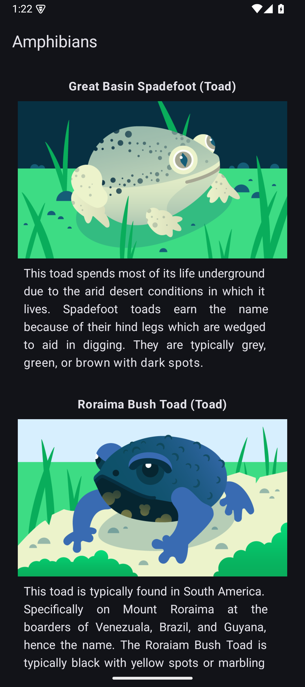
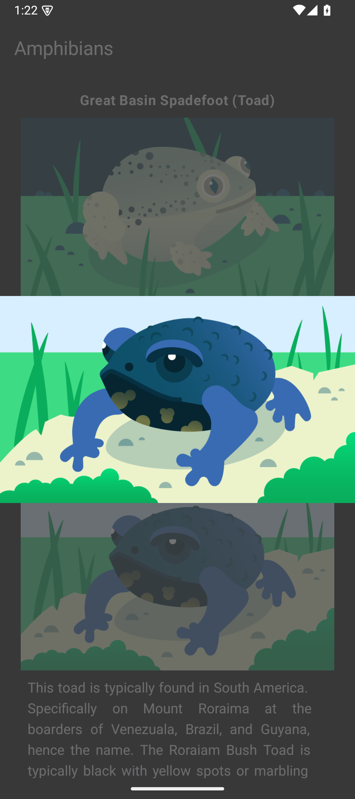

# 🐸 Amphibians App

An Android application built with **Kotlin and Jetpack Compose** that retrieves amphibian information and photos from a remote API using **Retrofit** and displays them in a scrollable list.




## 📱 Overview

The Amphibians app demonstrates how to build an Android application that consumes remote data from a REST API and presents it using modern Android development tools.

Users can browse a collection of amphibians, view their names, descriptions, and photos in a clean, simple interface.

## ✨ Features

- Retrieve amphibian data from a remote API.
- Fetch data using Retrofit.
- Display amphibian information in a scrollable LazyColumn.
- Load and display amphibian photos.
- Declarative UI built with Jetpack Compose.

## 🛠️ Built With

- **Kotlin** – Primary programming language.
- **Jetpack Compose** – Modern declarative UI toolkit.
- **Retrofit** – REST API communication.
- **Kotlin Serialization / Gson** – JSON parsing (depending on project configuration).
- **Coroutines** – Asynchronous operations.
- **Coil** – Image loading (if configured).

## 🏗️ Project Concepts

This project provides practical experience with:

- Consuming REST APIs.
- Making network requests with Retrofit.
- Parsing JSON responses into Kotlin data classes.
- Handling asynchronous operations.
- Displaying dynamic data using LazyColumn.
- Loading remote images in Jetpack Compose.

## 🚀 Getting Started

1. Clone the repository:

   ```bash
   git clone https://github.com/oelgazzar/Amphibians.git
   ```

2. Open the project in Android Studio.

3. Allow Gradle to sync and download the required dependencies.

4. Run the application on an Android emulator or physical device.

**Note:** An active internet connection is required to retrieve amphibian data and photos.

## 🎯 Purpose

This project was developed as part of the Android development learning journey, following the Amphibians app codelab. Its main goal is to practice networking fundamentals and integrating remote API data into a Jetpack Compose application.

---

*Built with Kotlin ❤️ and Jetpack Compose.*